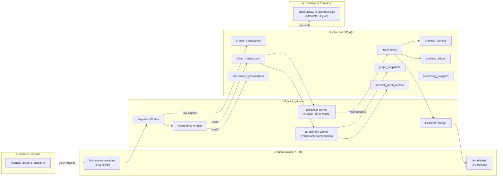
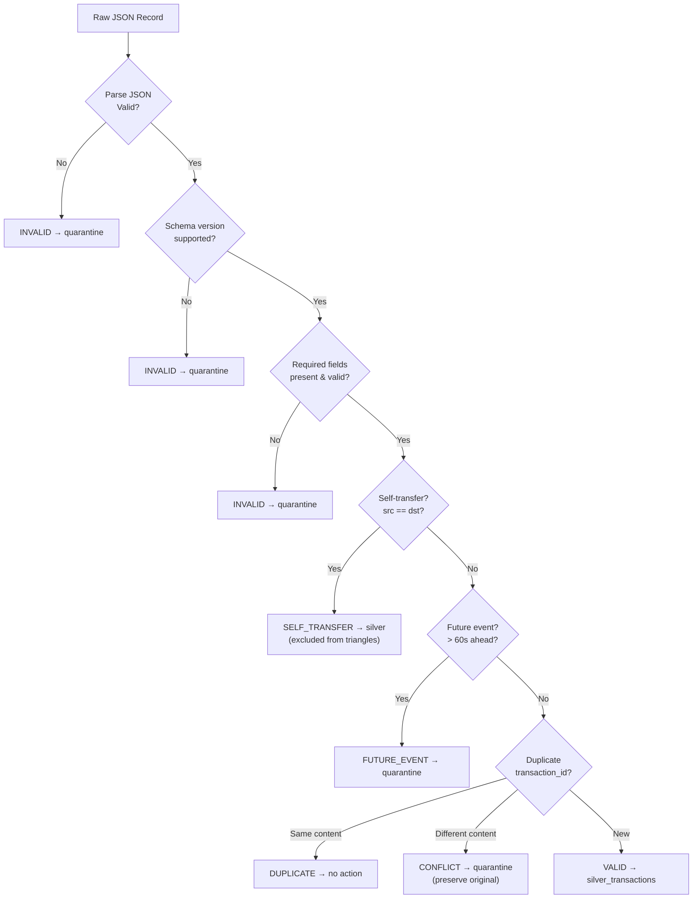
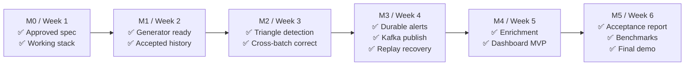

# 📋 Mini-Projet 17 — Detailed Project Realization Plan

## Graph Analytics & Blanchiment d'Argent (Anti-Money Laundering)

> [!IMPORTANT]
> This plan is derived from the analysis of [project_plan_and_specifications.md](file:///d:/INDIA/S5/Big%20Data/mini-projet/project_plan_and_specifications.md) and [dataset_specifications_and_integration_plan.md](file:///d:/INDIA/S5/Big%20Data/mini-projet/dataset_specifications_and_integration_plan.md). It provides a step-by-step actionable roadmap, technical guidance, and curated references for implementation.

---

## 1. Project Overview & Objectives

**Goal:** Build a real-time anti-money laundering (AML) system that:
1. Ingests financial transactions continuously via **Kafka → Spark Structured Streaming**
2. Builds directed transaction graphs and detects **three-account closed cycles** (triangles) using **GraphFrames motif finding**
3. Computes **PageRank** and **connected components** for account-level risk enrichment
4. Persists anomaly subgraphs in **Delta Lake** (partitioned by risk level and date)
5. Publishes alerts to **Kafka** (`fraud-alerts` topic)
6. Provides a **Streamlit + PyVis** investigation dashboard

**Four required entry points:**
- `financial_graph_producer.py` — Synthetic data generator
- `fraud_graph_delta_schema.py` — Delta schema initialization
- `spark_graph_fraud_streaming.py` — Main streaming pipeline
- `graph_network_dashboard.py` — Investigation UI

---

## 2. Technology Stack & Version Matrix

> [!CAUTION]
> Version compatibility is critical. A mismatch between Spark, Delta, and GraphFrames JVM artifacts will block development entirely. Pin versions in Milestone M0.

| Component | Recommended Version | Maven / pip Coordinates |
|---|---|---|
| **Apache Spark** | 3.5.x | — |
| **Delta Lake** | 3.3.x | `io.delta:delta-spark_2.12:3.3.0` / `delta-spark==3.3.0` |
| **GraphFrames** | 0.8.4-spark3.5 | `graphframes:graphframes:0.8.4-spark3.5-s_2.12` |
| **Scala** | 2.12 | Binary compatibility with all above |
| **Java** | 11 or 17 | JDK for Spark runtime |
| **Python** | 3.10–3.11 | PySpark compatibility |
| **Kafka** | 3.5+ (KRaft mode) | Bitnami or Confluent image |
| **confluent-kafka** (Python) | Latest stable | `pip install confluent-kafka` |
| **Spark Kafka Connector** | `spark-sql-kafka-0-10_2.12:3.5.x` | Bundled via `--packages` |
| **Streamlit** | 1.30+ | `pip install streamlit` |
| **PyVis** | 0.3.2+ | `pip install pyvis` |

### Spark Session Initialization
```python
spark = (
    SparkSession.builder.appName("AML-GraphAnalytics")
    .config("spark.sql.extensions", "io.delta.sql.DeltaSparkSessionExtension")
    .config("spark.sql.catalog.spark_catalog", "org.apache.spark.sql.delta.catalog.DeltaCatalog")
    .config("spark.jars.packages",
        "io.delta:delta-spark_2.12:3.3.0,"
        "graphframes:graphframes:0.8.4-spark3.5-s_2.12,"
        "org.apache.spark:spark-sql-kafka-0-10_2.12:3.5.1")
    .config("spark.sql.session.timeZone", "UTC")
    .getOrCreate()
)
```

**References:**
- [Delta Lake Release Compatibility](https://docs.delta.io/releases/)
- [GraphFrames Installation Guide](https://graphframes.io/02-quick-start/01-installation.html)
- [Spark Kafka Integration](https://spark.apache.org/docs/latest/streaming/structured-streaming-kafka-integration.html)

---

## 3. System Architecture



### Component Responsibilities

| Component | Input | Output | Key Behavior |
|---|---|---|---|
| **Producer** | Scenario config, seed | Kafka events + truth manifest | Seeded, rate-controlled, observable |
| **Ingestion** | Kafka records | `bronze_transactions` (Delta) | Immutable raw history, preserves offset metadata |
| **Acceptance** | Raw records | `silver_transactions` / `quarantined_transactions` | Deterministic validation (VALID/INVALID/DUPLICATE/CONFLICT/SELF_TRANSFER/FUTURE_EVENT) |
| **Detection** | Accepted transactions + history | `fraud_alerts` + evidence tables | Triangle motif finding within 10-min sliding windows |
| **Enrichment** | Transaction snapshots | `graph_snapshots` + `account_graph_metrics` | PageRank & connected components every 60s |
| **Publisher** | Persisted alerts | Kafka `fraud-alerts` | Idempotent publish with delivery tracking |
| **Dashboard** | All Delta tables | Investigation UI | Read-only, bounded, freshness-aware |

---

## 4. Detailed Phase-by-Phase Realization Plan

### Phase 0: Requirements & Architecture Approval (Days 1–2)

**Deliverables:**
- [ ] Approved specification document with all "Proposed" decisions validated
- [ ] Finalized version matrix (all exact versions recorded)
- [ ] Architecture diagrams signed off
- [ ] Temporal semantics (sliding window, watermark, lateness) approved

**Key Decisions to Resolve:**
| Decision | Options | Recommendation |
|---|---|---|
| Window slide interval | 30s (proposed) vs. 60s | 30s for finer granularity |
| Alert timing | Provisional on processing vs. wait for finalization | Provisional (faster alerts) |
| Currency handling | MAD-only vs. multi-currency | MAD baseline, multi-currency for datasets |
| Cycle semantics | Structural triangle vs. chronological ordering | Structural within window |

---

### Phase 1: Reproducible Environment Setup (Days 3–5)

**Objective:** Docker Compose stack with all services running and interoperability verified.

#### 1.1 Docker Compose Configuration

```yaml
# docker-compose.yml (outline)
services:
  kafka:
    image: bitnami/kafka:3.5
    environment:
      - KAFKA_ENABLE_KRAFT=yes
      - KAFKA_CFG_NODE_ID=1
      - KAFKA_CFG_PROCESS_ROLES=broker,controller
      - KAFKA_CFG_LISTENERS=PLAINTEXT://:9092,CONTROLLER://:9093
      - KAFKA_CFG_ADVERTISED_LISTENERS=PLAINTEXT://kafka:9092
    ports: ["9092:9092"]

  spark-app:
    build: ./docker/spark
    volumes:
      - ./data/delta:/opt/delta
      - ./data/checkpoints:/opt/checkpoints
    depends_on: [kafka]

  dashboard:
    build: ./docker/dashboard
    ports: ["8501:8501"]
    volumes:
      - ./data/delta:/opt/delta  # read-only
    depends_on: [spark-app]
```

> [!TIP]
> Use KRaft mode (no Zookeeper) for simpler setup. Ensure internal Kafka advertised addresses match container DNS names. Budget 4–8 CPU cores and 16 GB RAM.

#### 1.2 Environment Acceptance Tests (Must Pass Before Proceeding)

| Test | What to verify |
|---|---|
| Delta write/read | Create and read a Delta table |
| GraphFrame construction | Build a 3-node graph |
| Motif match | `(a)-[e1]->(b); (b)-[e2]->(c); (c)-[e3]->(a)` returns matches |
| PageRank | Execute with resetProbability=0.15, maxIter=10 |
| Connected components | Run on test graph with checkpointing |
| Kafka source/sink | Read from and write to Kafka topics |
| Checkpoint restart | Stop and resume a streaming query |

**Smoke test script pattern:**
```python
# Environment acceptance test
from graphframes import GraphFrame

# 1. Create test graph
v = spark.createDataFrame([("A",), ("B",), ("C",)], ["id"])
e = spark.createDataFrame([("A","B"), ("B","C"), ("C","A")], ["src","dst"])
g = GraphFrame(v, e)

# 2. Motif finding
triangles = g.find("(a)-[]->(b); (b)-[]->(c); (c)-[]->(a)")
assert triangles.count() > 0, "Motif finding failed"

# 3. PageRank
pr = g.pageRank(resetProbability=0.15, maxIter=10)
assert pr.vertices.count() == 3, "PageRank failed"

# 4. Connected Components (requires checkpoint dir)
spark.sparkContext.setCheckpointDir("/tmp/graphframes_checkpoints")
cc = g.connectedComponents()
assert cc.count() == 3, "Connected components failed"
```

**References:**
- [Docker Compose Kafka + Spark setup guide](https://dataengineerthings.org/)
- [Confluent KRaft Quick Start](https://docs.confluent.io/platform/current/get-started/platform-quickstart.html)
- [GraphFrames Quick Start](https://graphframes.io/02-quick-start/01-installation.html)

---

### Phase 2: Producer & Truth Fixtures (Days 6–8)

**Objective:** Deterministic synthetic data generator with fixed-seed repeatability.

#### 2.1 Producer Design (`financial_graph_producer.py`)

```text
Modes:
  --mode normal    → Random transactions, low cycle probability
  --mode triangle  → Guaranteed 3-account cycles within 10-min windows
  --mode mixed     → Normal traffic with injected known cycles
  --mode replay    → Replay from a saved fixture file

Parameters:
  --seed N         → Deterministic random seed
  --rate N         → Transactions per second
  --config PATH    → Configuration file path
```

**Transaction JSON Contract:**
```json
{
  "schema_version": 1,
  "transaction_id": "TXN-2026-8821",
  "source_account": "ACC-8812",
  "target_account": "ACC-4490",
  "montant": 45000.00,
  "devise": "MAD",
  "type_operation": "VIREMENT_COMMERCIAL",
  "timestamp": "2026-10-07T10:15:00Z"
}
```

#### 2.2 Scenario Fixtures

Create controlled fixtures for acceptance tests:

| Fixture | Purpose | Expected Result |
|---|---|---|
| `triangle_simple.json` | 3 accounts, 3 edges, same 10-min window | Exactly 1 alert |
| `triangle_cross_batch.json` | Edges arrive in 3 separate batches | Detection after final edge |
| `open_chain.json` | A→B→C (no closing edge) | No alert |
| `self_loop.json` | A→A edge | Excluded from detection |
| `boundary_events.json` | Events at exact window boundary | Half-open membership tested |
| `duplicate_txn.json` | Same transaction_id, same content | No new alert |
| `conflict_txn.json` | Same transaction_id, different content | Original preserved, conflict quarantined |

> [!NOTE]
> **IBM AMLSim inspiration:** The IBM AMLSim project ([github.com/IBM/AMLSim](https://github.com/IBM/AMLSim)) provides a sophisticated multi-agent transaction simulator. While its dependency stack is dated, its pattern injection approach (fan-in, fan-out, cycles of 3–6 accounts) can inspire your scenario design. Do not import its environment—consume exported patterns only.

**References:**
- [IBM AMLSim Generator](https://github.com/IBM/AMLSim)
- [AMLworld Research Paper](https://ar5iv.labs.arxiv.org/html/2306.16424)
- [Confluent Python Client](https://docs.confluent.io/kafka-clients/python/current/overview.md)

---

### Phase 3: Raw Ingestion & Acceptance Pipeline (Days 9–12)

**Objective:** Bronze → Silver → Quarantine pipeline with deterministic validation.

#### 3.1 Ingestion Worker

```python
# Read from Kafka → append to bronze_transactions (Delta)
raw_stream = (
    spark.readStream
    .format("kafka")
    .option("kafka.bootstrap.servers", config.kafka_bootstrap)
    .option("subscribe", "financial-transactions")
    .option("startingOffsets", "earliest")
    .load()
)

# Preserve all provenance metadata
bronze_df = raw_stream.select(
    col("value").cast("string").alias("raw_json"),
    col("topic"), col("partition"), col("offset"),
    current_timestamp().alias("ingest_time"),
    date_format(current_timestamp(), "yyyy-MM-dd").alias("dt")
)

# Write to Delta bronze table
bronze_query = (
    bronze_df.writeStream
    .format("delta")
    .outputMode("append")
    .option("checkpointLocation", f"{config.checkpoint_path}/bronze")
    .start(config.bronze_table_path)
)
```

#### 3.2 Acceptance Worker

The acceptance worker must implement deterministic validation with six outcomes:



**Key design decisions:**
- **Canonical hash:** `SHA256(transaction_id + src + dst + amount + currency + operation_type + event_time)` — excludes arrival metadata
- **Single writer:** One acceptance thread serializes identity decisions
- **Deterministic under replay:** Same input always produces same output

#### 3.3 Delta Table Schema Design

```python
# fraud_graph_delta_schema.py (outline)
BRONZE_SCHEMA = StructType([
    StructField("raw_json", StringType()),
    StructField("topic", StringType()),
    StructField("partition", IntegerType()),
    StructField("offset", LongType()),
    StructField("ingest_time", TimestampType()),
    StructField("dt", StringType())  # partition column
])

SILVER_SCHEMA = StructType([
    StructField("transaction_id", StringType()),
    StructField("src", StringType()),
    StructField("dst", StringType()),
    StructField("amount", DecimalType(18, 2)),
    StructField("currency", StringType()),
    StructField("operation_type", StringType()),
    StructField("event_time", TimestampType()),
    StructField("ingest_time", TimestampType()),
    StructField("payload_hash", StringType()),
    StructField("online_eligible", BooleanType()),
    StructField("dt", StringType())  # partition column
])
```

> [!TIP]
> **Delta Lake Merge for Idempotency:** Use `MERGE INTO` with `alert_id` as the match key. Always include the partition column in the merge condition for partition pruning. Deduplicate the source DataFrame before merging to avoid "multiple source rows matched" errors.

**References:**
- [Delta Lake Streaming Reads/Writes](https://docs.delta.io/delta-streaming/)
- [Delta Merge/Update Documentation](https://docs.delta.io/delta-update/)
- [Spark Structured Streaming APIs](https://spark.apache.org/docs/latest/streaming/apis-on-dataframes-and-datasets.html)

---

### Phase 4: Temporal Graph Detection (Days 13–17)

**Objective:** Sliding-window triangle detection with correct temporal semantics.

This is the **most complex and critical phase**. It requires bridging Spark Structured Streaming (stateful) with GraphFrames (batch-only).

#### 4.1 Architectural Pattern: `foreachBatch` + GraphFrames

> [!WARNING]
> GraphFrames is fundamentally a **batch-oriented** library. It cannot perform incremental streaming graph updates. The standard pattern uses `foreachBatch` to materialize micro-batch DataFrames into GraphFrame snapshots.

```python
def detect_cycles(batch_df, batch_id):
    """Process each micro-batch for triangle detection."""
    if batch_df.rdd.isEmpty():
        return

    # 1. Identify affected windows for new transactions
    new_txns = batch_df.filter(col("online_eligible") == True)
    affected_windows = compute_affected_windows(new_txns, window_length=600, slide=30)

    # 2. For each affected window, recover full history
    for window_start, window_end in affected_windows:
        window_txns = get_window_transactions(
            silver_table_path, window_start, window_end
        )

        if window_txns.rdd.isEmpty():
            continue

        # 3. Build GraphFrame
        edges = window_txns.select(
            col("src"), col("dst"),
            col("transaction_id"), col("amount"),
            col("currency"), col("event_time")
        )
        vertices = (
            edges.select(col("src").alias("id"))
            .union(edges.select(col("dst").alias("id")))
            .distinct()
        )
        graph = GraphFrame(vertices, edges)

        # 4. Find triangles via motif
        matches = graph.find(
            "(a)-[e1]->(b); (b)-[e2]->(c); (c)-[e3]->(a)"
        )

        # 5. Apply mandatory filters
        candidates = matches.filter(
            (col("a.id") != col("b.id")) &
            (col("b.id") != col("c.id")) &
            (col("a.id") != col("c.id")) &
            (col("e1.transaction_id") != col("e2.transaction_id")) &
            (col("e2.transaction_id") != col("e3.transaction_id")) &
            (col("e1.transaction_id") != col("e3.transaction_id")) &
            (col("e1.currency") == col("e2.currency")) &
            (col("e2.currency") == col("e3.currency"))
        )

        # 6. Require at least one newly accepted edge
        candidates = filter_requires_new_edge(candidates, new_txns)

        # 7. Compute canonical IDs and persist
        alerts = compute_alert_identities(candidates)
        persist_alerts_idempotently(alerts)
```

#### 4.2 Sliding Window Semantics

```text
Window: L = 600 seconds (10 minutes), Slide S = 30 seconds
Membership: window_start <= event_time < window_end (half-open)
Watermark: 2 minutes (120 seconds)
```

**Application event-time high-water mark policy:**
1. Read previous committed H
2. Classify new timestamps against W = H − 120s
3. Events older than W → retained but marked retrospective-only
4. Eligible events → update candidate windows
5. Persist alerts idempotently
6. Advance H only after outputs succeed

#### 4.3 Alert Identity (Deterministic & Stable)

```python
import hashlib, json

def compute_cycle_id(transaction_ids: list) -> str:
    """SHA256 of sorted transaction IDs → stable across window overlaps."""
    canonical = json.dumps(sorted(transaction_ids), separators=(",", ":"))
    return hashlib.sha256(canonical.encode()).hexdigest()

def compute_alert_id(rule_id: str, rule_version: int, cycle_id: str) -> str:
    """SHA256 of [rule_id, rule_version, cycle_id]."""
    canonical = json.dumps([rule_id, rule_version, cycle_id], separators=(",", ":"))
    return hashlib.sha256(canonical.encode()).hexdigest()
```

> [!IMPORTANT]
> The same evidence set matching overlapping windows produces **one logical alert**. Window membership does not enter alert identity. This prevents duplicate alerts for the same cycle appearing in multiple overlapping 10-minute windows.

#### 4.4 Risk Classification

| Level | Condition | Note |
|---|---|---|
| **HIGH** | min(edge amounts) ≥ HIGH_THRESHOLD AND max/min ratio ≤ TOLERANCE | Configurable, uncalibrated |
| **MEDIUM** | min(edge amounts) ≥ MEDIUM_THRESHOLD | Configurable, uncalibrated |
| **LOW** | All other qualifying cycles | Default |

**References:**
- [GraphFrames Motif Finding](https://graphframes.io/04-user-guide/04-motif-finding.html)
- [Databricks AML Accelerator](https://github.com/databricks-industry-solutions/anti-money-laundering) — Open-source notebooks for AML graph analytics with GraphFrames, including round-tripping detection and risk propagation
- [NVIDIA GNN Fraud Detection Blueprint](https://www.nvidia.com/) — For future ML-based enhancement (out of scope)

---

### Phase 5: Durable Alerts & Kafka Publication (Days 18–21)

**Objective:** Persisted explainable alerts with idempotent Kafka publishing.

#### 5.1 Alert Persistence (Delta Lake)

```python
# Idempotent merge by alert_id
from delta.tables import DeltaTable

def persist_alerts_idempotently(new_alerts_df):
    target = DeltaTable.forPath(spark, config.fraud_alerts_path)

    (target.alias("t")
     .merge(
         new_alerts_df.alias("s"),
         "t.alert_id = s.alert_id AND t.dt = s.dt"  # partition pruning!
     )
     .whenMatchedUpdate(
         condition="t.first_detected_at > s.first_detected_at",
         set={"first_detected_at": "s.first_detected_at"}
     )
     .whenNotMatchedInsertAll()
     .execute()
    )
```

#### 5.2 Alert Publication to Kafka

**Publication algorithm:**
1. Select durable alert rows lacking publication progress
2. Serialize exact stored payload with `alert_id` as Kafka key
3. Wait for acknowledged delivery callback
4. Record publication progress in `publication_progress` table

```python
from confluent_kafka import Producer

def publish_alerts(unpublished_alerts):
    producer = Producer({"bootstrap.servers": config.kafka_bootstrap})

    for alert in unpublished_alerts.collect():
        producer.produce(
            topic="fraud-alerts",
            key=alert.alert_id.encode(),
            value=json.dumps(alert.payload).encode(),
            callback=delivery_callback
        )
    producer.flush()
```

> [!NOTE]
> Kafka provides **at-least-once** delivery. A crash between delivery acknowledgment and progress recording may duplicate delivery. Consumers MUST deduplicate by `alert_id`.

#### 5.3 Alert JSON Schema

```json
{
  "schema_version": 1,
  "alert_id": "<stable SHA256 hash>",
  "rule_id": "TEMPORAL_TRIANGLE",
  "rule_version": 1,
  "risk_level": "MEDIUM",
  "reason_codes": ["DIRECTED_TRIANGLE", "SAME_CURRENCY"],
  "account_ids": ["ACC-001", "ACC-002", "ACC-003"],
  "transaction_ids": ["TXN-001", "TXN-002", "TXN-003"],
  "currency": "MAD",
  "event_time_min": "2026-10-07T10:10:00Z",
  "event_time_max": "2026-10-07T10:12:00Z",
  "first_detected_at": "<UTC timestamp>",
  "metrics_snapshot_id": null
}
```

---

### Phase 6: Enrichment Pipeline (Days 22–23)

**Objective:** Periodic PageRank and connected components computation.

#### 6.1 Enrichment Worker

```python
def run_enrichment(spark, config):
    """Every 60 seconds, compute graph metrics on latest snapshot."""
    # 1. Select latest 10-minute interval from silver_transactions
    snapshot_txns = get_recent_transactions(config.silver_path, window_minutes=10)

    # 2. Build graph
    edges = snapshot_txns.select("src", "dst", "transaction_id", "amount", "event_time")
    vertices = derive_vertices(edges)
    graph = GraphFrame(vertices, edges)

    # 3. PageRank (resetProbability=0.15, maxIter=10)
    pr = graph.pageRank(resetProbability=0.15, maxIter=10)

    # 4. Connected Components (requires separate checkpoint dir!)
    spark.sparkContext.setCheckpointDir(config.graph_checkpoint_path)
    cc = graph.connectedComponents()

    # 5. Join and persist
    metrics = (pr.vertices
        .join(cc, "id")
        .withColumn("snapshot_id", lit(snapshot_id))
        .withColumn("computed_at", current_timestamp()))

    metrics.write.format("delta").mode("append").save(config.account_metrics_path)

    # 6. Cleanup
    graph.vertices.unpersist()
    graph.edges.unpersist()
```

> [!WARNING]
> **Graph checkpoint paths MUST differ from streaming query checkpoint paths.** GraphFrames' connected components algorithm requires checkpointing, and using the same directory will corrupt streaming state.

**References:**
- [GraphFrames PageRank / Centrality](https://graphframes.io/04-user-guide/03-centralities.html)
- [GraphFrames Connected Components / Traversals](https://graphframes.io/04-user-guide/05-traversals.html)

---

### Phase 7: Investigation Dashboard (Days 24–26)

**Objective:** Streamlit + PyVis interactive investigation interface.

#### 7.1 Dashboard Views

| View | Elements | Data Source |
|---|---|---|
| **Overview** | Alert counts, severity distribution, processing freshness | `fraud_alerts` aggregate |
| **Alert List** | Filterable table (date, risk, account, rule) | `fraud_alerts` |
| **Investigation** | Directed cycle graph (PyVis), evidence table | `anomaly_vertices` + `anomaly_edges` |
| **Account Profile** | Associated alerts, latest metrics (PageRank, component) | `account_graph_metrics` |
| **Health** | Last batch, lag, errors, retrospective-only count | `processing_progress` |

#### 7.2 PyVis Integration Pattern

```python
import streamlit as st
import streamlit.components.v1 as components
from pyvis.network import Network

def render_alert_graph(alert_id):
    """Render directed cycle evidence graph for a specific alert."""
    # Load evidence edges from Delta
    edges_df = spark.read.format("delta").load(config.anomaly_edges_path)
    alert_edges = edges_df.filter(col("alert_id") == alert_id).toPandas()

    # Create directed PyVis network
    net = Network(height="500px", width="100%", directed=True,
                  bgcolor="#0e1117", font_color="white")

    # Add nodes and edges with transaction details
    for _, row in alert_edges.iterrows():
        net.add_node(row["src"], label=row["src"], color="#ff6b6b")
        net.add_node(row["dst"], label=row["dst"], color="#ff6b6b")
        net.add_edge(
            row["src"], row["dst"],
            title=f"TXN: {row['transaction_id']}\n"
                  f"Amount: {row['amount']} {row['currency']}\n"
                  f"Time: {row['event_time']}",
            label=f"{row['amount']}",
            color="#ffd93d"
        )

    # Render in Streamlit
    net.save_graph("graph.html")
    with open("graph.html", "r") as f:
        components.html(f.read(), height=520)
```

#### 7.3 Performance Guardrails

- **Bound neighborhood expansion:** Max 300 nodes / 1,000 edges
- **Streamlit caching:** Use `@st.cache_data(ttl=60)` for Delta reads
- **Show data freshness:** Display when cached data and metrics were computed
- **Escape untrusted labels/HTML** in graph rendering
- **Never invoke global PageRank** during page rendering

**References:**
- [PyVis Documentation](https://pyvis.readthedocs.io/en/latest/documentation.html)
- [Streamlit Caching](https://docs.streamlit.io/develop/concepts/architecture/caching)
- [Streamlit + PyVis integration examples](https://github.com/napoles-uach/streamlit_network)

---

### Phase 8: Benchmarks, Testing & Handover (Days 27–29)

**Objective:** Comprehensive testing, performance benchmarks, and delivery package.

#### 8.1 Acceptance Test Matrix (22 Tests)

| ID | Test | Pass Criterion |
|---|---|---|
| AT-01 | Known triangle inside one window | Exactly one logical alert |
| AT-02 | Same triangle rotated vertex labels | Same alert_id |
| AT-03 | Edges arrive in three batches | Detection after final eligible edge |
| AT-04 | Open chain (A→B→C) | No triangle alert |
| AT-05 | Repeated account / self-loop | Excluded from rule |
| AT-06 | No common 10-min window | No alert |
| AT-07 | Boundary events at window end | Half-open membership respected |
| AT-08 | Same cycle in overlapping windows | One logical alert |
| AT-09 | Out-of-order final edge | Alert with correct evidence |
| AT-10 | Event older than watermark | Retained, retrospective-only |
| AT-11 | Duplicate transaction | No new logical transaction |
| AT-12 | Conflicting payload | Original unchanged, conflict quarantined |
| AT-13 | Malformed JSON / invalid decimal | Quarantine, query continues |
| AT-14 | Future timestamp beyond tolerance | Rejected |
| AT-15 | Mixed currencies in cycle | Excluded from baseline rule |
| AT-16 | Four-account cycle only | No three-account alert |
| AT-17 | High-centrality hub | Metrics present, no fraud claim |
| AT-18 | Historical alert retrieval | Exact evidence reconstructed |
| AT-19 | Restart with checkpoint | No logical duplicates |
| AT-20 | Kafka publish then crash | Same alert identity on redelivery |
| AT-21 | Idle stream | No false finalization assumption |
| AT-22 | Benchmark target | Measured result with workload info |

#### 8.2 Performance Benchmarks

| Level | Rate | Purpose |
|---|---|---|
| **L1** | 10 txn/s | Functional correctness |
| **L2** | 100 txn/s | Moderate load |
| **L3** | 500 txn/s | Stress test / target |

**Target:** p95 initial-alert latency < 1 second under agreed workload.

**Metrics to record per benchmark:**
- Hardware specs, software versions
- Window/slide configuration
- Active graph size (vertices, edges)
- Input rate and run duration
- Motif candidate count
- Detection latency (p50, p95, p99)
- Memory and shuffle indicators

---

## 5. Dataset Integration Plan

### 5.1 Execution Sequence

| Step | Dataset | Size | Purpose |
|---|---|---|---|
| 1 | Controlled fixtures (20–100 events) | Tiny | Rule correctness proof |
| 2 | AMLSim 100 vertices / 10K edges | Small | Ingestion + graph construction |
| 3 | AMLSim 1K vertices / 100K edges | Medium | Pattern inspection + benchmark |
| 4 | IBM HI-Small (continuous slice) | ~5M txns | Adaptation + replay validation |
| 5 | Full HI-Small | ~5M txns | Full benchmark |
| 6 | IBM LI-Small | ~7M txns | Lower-prevalence comparison |
| 7 | Medium/Large variants | 32M–180M | Optional scale experiments |

### 5.2 Dataset Adapter (`dataset_adapter.py`)

| Source Concept | Project Field | Rule |
|---|---|---|
| Sending bank + account | `source_account` | Composite identity (bank:account) |
| Receiving bank + account | `target_account` | Include bank to avoid collisions |
| Timestamp | `timestamp` | Parse timezone, convert to UTC |
| Amount paid | `montant` | Decimal, preserve original values |
| Payment currency | `devise` | Preserve source currency |
| Payment format | `type_operation` | Versioned lookup mapping |
| Laundering label | Evaluation-only | **Never** detector input |

> [!CAUTION]
> External IBM datasets MUST NOT be relabeled as MAD without conversion. The laundering labels describe laundering patterns, NOT "three-account cycle within ten minutes." Do not equate them.

### 5.3 Replay Modes

| Mode | Behavior |
|---|---|
| **Original-time** | Preserve business timestamps, rate-limit Kafka publication |
| **Shifted-time** | Apply constant offset: `new_time = original_time + (replay_start - dataset_start)` |
| **Accelerated** | Publish faster, keep business timestamps unchanged |
| **Compressed** | Scale event-time intervals (changes semantics — label results as demonstrations) |

**References:**
- [IBM AML Dataset (Kaggle)](https://www.kaggle.com/datasets/ealtman2019/ibm-transactions-for-anti-money-laundering-aml/data)
- [IBM AML-Data Provenance](https://github.com/IBM/AML-Data)
- [IBM AMLSim Data Sizes](https://github.com/IBM/AMLSim/wiki/Download-Example-Data-Set)

---

## 6. Project File Structure

```text
mini-projet/
├── docker/
│   ├── docker-compose.yml
│   ├── spark/
│   │   └── Dockerfile
│   └── dashboard/
│       └── Dockerfile
├── src/
│   ├── financial_graph_producer.py      # Entry point 1
│   ├── fraud_graph_delta_schema.py      # Entry point 2
│   ├── spark_graph_fraud_streaming.py   # Entry point 3
│   ├── graph_network_dashboard.py       # Entry point 4
│   ├── dataset_adapter.py              # External dataset adapter
│   ├── validation.py                   # Transaction validation logic
│   ├── temporal_policy.py             # Window/watermark/lateness logic
│   ├── graph_builder.py               # GraphFrame construction
│   ├── cycle_identities.py            # SHA256 identity computation
│   ├── persistence.py                 # Delta read/write helpers
│   ├── publication.py                 # Kafka publisher
│   └── metrics.py                     # Logging and observability
├── config/
│   ├── default.yaml                   # Default configuration
│   └── test.yaml                      # Test configuration
├── tests/
│   ├── fixtures/                      # Controlled test data
│   ├── test_validation.py
│   ├── test_detection.py
│   ├── test_identities.py
│   ├── test_acceptance.py             # AT-01 through AT-22
│   └── test_dataset_adapter.py        # DS-AT-01 through DS-AT-10
├── data/
│   ├── delta/                         # Delta Lake tables
│   ├── checkpoints/                   # Streaming checkpoints
│   ├── graph_checkpoints/             # GraphFrames checkpoints (SEPARATE!)
│   └── datasets/                      # External datasets (.gitignore'd)
├── docs/
│   ├── architecture.md
│   ├── runbook.md
│   └── limitations.md
├── requirements.txt
├── .gitignore
└── README.md
```

---

## 7. Weekly Milestone Summary



| Week | Milestone | Deliverables | Gate |
|---|---|---|---|
| **1** | M0 | Approved spec, Docker Compose stack, smoke tests | All environment tests pass |
| **2** | M1 | Producer + fixtures, bronze/silver/quarantine pipeline | Validation + replay + conflict tests pass |
| **3** | M2 | Temporal triangle detection across batches | AT-01 through AT-16 pass |
| **4** | M3 | Durable alerts, Kafka publication, failure recovery | Failure/restart tests pass |
| **5** | M4 | Enrichment pipeline, Streamlit/PyVis dashboard | Investigation workflow functional |
| **6** | M5 | Acceptance report, benchmarks, runbook, final demo | All 22 ATs pass, reproducible delivery |

---

## 8. Risk Mitigation Matrix

| Risk | Impact | Mitigation | Trigger |
|---|---|---|---|
| Spark/Delta/GraphFrames version mismatch | **Blocks all development** | Pin and smoke-test in M0 | Any JVM/classpath failure |
| Window semantic ambiguity | Wrong acceptance criteria | Get supervisor approval before coding | Evaluator expects different model |
| Motif combinatorial explosion | Latency/OOM | Bounded windows, candidate metrics, load tests | Growing backlog or spill |
| Late data misses cycles | Incorrect detection | Affected-window recovery + boundary fixtures | AT-09/10 failure |
| Sub-second target infeasible | Requirement unmet | Early benchmark + explicit change request | p95 above target at L2 |
| UI overload on large graphs | Unusable demo | Evidence-first bounded views (300 nodes max) | Browser latency/memory growth |

---

## 9. Key External Resources & References

### Official Documentation
| Resource | URL | Used For |
|---|---|---|
| Spark Structured Streaming | https://spark.apache.org/docs/latest/streaming/apis-on-dataframes-and-datasets.html | Watermarks, windows, foreachBatch |
| Spark Kafka Integration | https://spark.apache.org/docs/latest/streaming/structured-streaming-kafka-integration.html | Source/sink options, at-least-once writes |
| GraphFrames Motif Finding | https://graphframes.io/04-user-guide/04-motif-finding.html | Triangle DSL and filters |
| GraphFrames PageRank | https://graphframes.io/04-user-guide/03-centralities.html | PageRank API/parameters |
| GraphFrames Components | https://graphframes.io/04-user-guide/05-traversals.html | Components, checkpoints |
| GraphFrames Python API | https://graphframes.io/api/python/graphframes.html | Exact API signatures |
| Delta Lake Streaming | https://docs.delta.io/delta-streaming/ | Idempotent writes, streaming recovery |
| Delta Lake Merge/Update | https://docs.delta.io/delta-update/ | Deterministic upserts |
| Delta Release Compatibility | https://docs.delta.io/releases/ | Spark/Delta version selection |
| PyVis Documentation | https://pyvis.readthedocs.io/en/latest/documentation.html | Directed graph rendering |
| Streamlit Caching | https://docs.streamlit.io/develop/concepts/architecture/caching | TTL, bounded caching |
| Confluent Python Client | https://docs.confluent.io/kafka-clients/python/current/overview.md | Producer callbacks |

### Open-Source Projects & Accelerators
| Resource | URL | Relevance |
|---|---|---|
| **Databricks AML Accelerator** | https://github.com/databricks-industry-solutions/anti-money-laundering | PySpark + GraphFrames AML notebooks (round-tripping, structuring, risk propagation) |
| **IBM AMLSim** | https://github.com/IBM/AMLSim | Synthetic AML transaction generator (pattern injection) |
| **IBM AML-Data** | https://github.com/IBM/AML-Data | Synthetic labeled transaction datasets |
| **AMLSim Example Data** | https://github.com/IBM/AMLSim/wiki/Download-Example-Data-Set | Pre-generated graph datasets |
| **AMLworld Paper** | https://ar5iv.labs.arxiv.org/html/2306.16424 | Generator methodology & limitations |
| **IBM AML Kaggle Dataset** | https://www.kaggle.com/datasets/ealtman2019/ibm-transactions-for-anti-money-laundering-aml/data | HI-Small/LI-Small download |

### Tutorials & Community Resources
| Resource | Topic |
|---|---|
| Spark + GraphFrames streaming fraud detection (Medium) | `foreachBatch` + motif finding pattern |
| Databricks AML blog series | Graph analytics for financial crime |
| Docker Compose Kafka + Spark setup guides | Local development environment |
| Streamlit + PyVis network dashboard examples | Interactive graph rendering |

---

## 10. Definition of Done Checklist

- [ ] All 22 acceptance tests (AT-01 through AT-22) pass
- [ ] All 10 dataset acceptance tests (DS-AT-01 through DS-AT-10) pass
- [ ] Four required entry points exist and are documented
- [ ] One-command or sequenced setup works from clean environment
- [ ] Fixed-seed generation reproduces the demonstration
- [ ] Cross-batch, late-event, duplicate, conflict, and restart tests pass
- [ ] An alert can be reconstructed from persisted evidence **without Kafka**
- [ ] Kafka duplicate delivery limitations documented
- [ ] Dashboard shows freshness and graph-metric provenance
- [ ] Performance report includes workload, hardware, versions, and unmet targets
- [ ] README, architecture, schemas, runbook, test report, and limitations included

**Final demo flow:**
> Normal traffic → three edges across separate batches → one stable alert → graph evidence → replay → restart → enrichment context → measured performance

